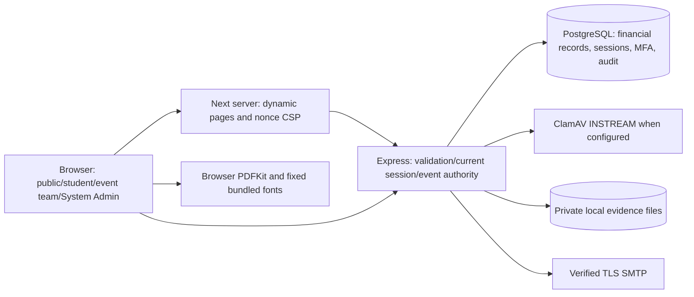
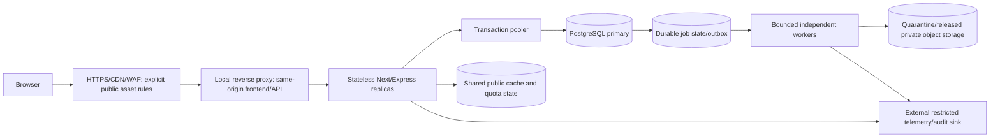

# Scalability architecture and trust boundaries

Status: current-state architecture and target contracts, not a deployment or capacity certification. Base `415a869`. Read [PLAN.md](PLAN.md), the generated inventory and phase evidence before implementation. Current app is a university society event-finance/registration/complaint platform; no academic results/grade model, payment processor/webhook, SMS, import engine or server PDF renderer exists.

## Current request and data paths

The browser is untrusted. Next navigation is not authorization. Express authenticates a live bound DB session; services resolve owning event/student and transactions recheck current authority. PostgreSQL is currently authoritative for permissions, account guessing budgets, MFA consumption, refresh rotation, retry markers and money history. The application runtime's existing superuser credential is an open boundary failure (SEC-22). Filesystem/AV/SMTP/OS credentials are separate trusted dependencies. Public projections must exclude individual payments/student data/evidence.

## Target tiers and adapter contracts

This is the intended growth topology. No cache/queue/object store/pooler/collector is installed or measured by this diagram. One VPS may collocate components only after measured total memory/CPU headroom; replicas move those adapters to shared services without weakening checks.

| Adapter | Required invariant | Current implementation / migration constraint |
| --- | --- | --- |
| Database / read routing | Primary for auth, money, permission/status and immediate read-your-write. Replica reads only for explicitly stale-safe public data. Pooler must preserve transaction semantics. | Prisma/PostgreSQL; serializable governance transactions and bounded retries coordinate writes; session creation uses repeatable read. There is no global advisory lock. Measure actual row/index/serialization contention before changing it. |
| Sessions | Revocation/version/MFA assurance checked against authoritative durable state; compromise of a cache must not mint authority. | PostgreSQL-bound access/refresh sessions already shared; no rewrite to cache-only sessions. |
| Rate limits | Atomic shared total, validated trusted identity/IP, bounded TTL/cardinality, isolated namespaces, fail closed for sensitive operations. | Process-local outer quotas/admission; DB account failure budget is already shared. Distributed behavior needs explicit review/approval. |
| Cache | Public allow-listed projections only in shared layers; per-user/no-store private data; versioned keys/invalidation/stampede ownership. | No shared cache; Next nonce HTML/private projections cannot be shared automatically. |
| Jobs / outbox | Atomic intent with domain transaction, owned jobs, idempotent transitions, retries/dead-letter, quotas/leases and bounded worker resource use. | Hourly local token pruning and immediate report/scanner/mail paths. Preserve report snapshot and audit atomicity. |
| File storage | Opaque object IDs, private read authorization through storage adapter, quarantine before release, safe content limits/scans, no execution. | Local write/delete adapter; protected fs.stat/sendFile reads bypass the adapter and must be included in future migration. |
| Email | Durable idempotent delivery, verified TLS, no capability logs, no unapproved automatic external test service. | Configured SMTP uses TLS. Unconfigured mail may create an external Ethereal test account: never exercise that fallback during local-only tests. |
| PDF | Fixed assets/structured content, bounded export resources and authorization of input. | Browser PDFKit already avoids server HTML rendering/SSRF/file-read interfaces; introducing a server renderer needs demonstrated benefit and a new threat review. |
| Telemetry | Controlled route labels, no tokens/PII/bodies/queries, bounded cardinality and independently protected audit collection. | Redacted application request log and transactional DB audit; collector/RED/USE tracing not deployed. |

## ADR-0001 — preserve the security branch and authoritative boundaries

Decision: derive from current security tip, keep main untouched, preserve supervised MFA, event permissions, current transactions and public disclosure policy. Measure/prove narrower changes before replacing any boundary. Alternatives rejected: removing transaction rechecks or using a stale authorization cache to raise RPS. Rollback: each concern is a separate branch commit; reverting code must never undo a committed business transaction or weaken an applied data invariant.

## ADR-0002 — synthetic workload, real implementations, separate environments

Decision: benchmark generated fake data on a dedicated isolated database and private upload root, with real bcrypt/MFA/validation/scanning/DB/HTTP/browser paths. Record native Windows separately from resource-limited Linux/Compose. Existing accounts, evidence and MFA are outside the benchmark dataset. Absent journeys are N/A; do not fabricate results pages or payment gateways. Rollback: stop only owned test processes; preserve data until approved cleanup, never reseed/reset the owner's database.

## ADR-0003 — small VPS is a measured launch constraint

Decision: design shared-state adapters for later replicas, but certify only environments actually tested. A 2 CPU/4 GB budget must include OS/proxy/DB/cache/AV/apps/workers, not just Node. Real antivirus memory/signature requirements may exceed a collocated budget; that is a deployment sizing gate. Cloudflare free service is an intended edge, not configured capacity, an authorization boundary or a replacement for shared backend quotas. Cost projections use provisioned resource classes and trigger metrics, not invented vendor prices.

## Review and rollback requirements

Every new adapter requires provenance/pinned version/license/advisory review, explicit startup validation, timeouts/backpressure, leak/abuse/concurrency/failure tests and compatibility measurements. Permission/auth changes and real-data migrations wait for approval. Expand-contract/online-index plans must include original-state capture, deployment sequencing, backward compatibility and a rollback that preserves financial/audit data. Exact implementation ADRs are added with their evidence; this document grants no migration or deployment permission.
